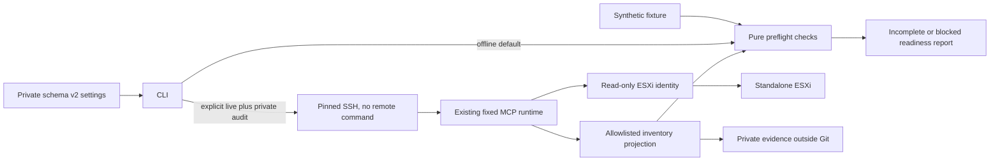

# Architecture

The operational boundary is workstation → restricted SSH → MCP server → standalone
ESXi. The MCP service holds the ESXi credential and verifies ESXi TLS. The client
holds only its dedicated transport key and verified MCP host pin. Standalone ESXi
is independent of whether the eventual ISE VM runs one or several personas.

`config.py` validates configuration without opening keys or making network calls.
`mcp_client.py` fixes the executable and SSH restrictions in code. It ignores
shared SSH configuration and agents, verifies the expected fingerprint, and
requires exactly the four existing parameterless tools. It checks target host
identity before requesting the other inventories. Every response needs a recent,
timezone-aware observation timestamp. It performs no automatic retries.

`preflight.py` evaluates a minimal projection. The adapter uses null for absent
CPU topology, API type, port groups and datastore maintenance state; it never
fabricates these fields from aggregate metrics. Reports preserve these gaps.
`audit.py` records fixed events, a projected inventory and a report in an owner-only
run directory outside any Git checkout. It does not record raw protocol messages,
SSH stderr, credentials or tool descriptions. `planning.py` produces only an outline.

The live tools are `esxi_host_health`, `esxi_vm_inventory`,
`esxi_datastore_usage`, and `esxi_snapshot_inventory`, each called once with `{}`.
Read-only annotations are checked as a contract signal, not treated as permission
enforcement. Server code and the ESXi role remain the enforcement boundaries.
The four observations are sequential, not an atomic host snapshot, and establish
only what the credential can see. No resources are reserved by a preflight.

The reviewed Home AI runtime uses direct-host pyVmomi reads. Its transient view
creation/destruction and login/logout affect session bookkeeping, not VM state.
The current tools do not prove `about.apiType == HostAgent`, RBAC coverage, or
server code provenance; these remain administrator verification gates.

## Failure and lifetime behavior

The optional MCP SDK is pinned to the tested version. Each request has the configured
client timeout; a collection also has a deadline of `20 + 5 * timeout_seconds`.
SDK transport cleanup can extend elapsed time beyond that deadline. Closing the
local SSH transport does not prove a blocked remote SDK operation has stopped or
its ESXi session has logged out. Do not retry a timeout blindly.

Responses over 1 MiB are rejected after SDK decoding. This is an application
validation limit, not a streaming memory bound inside the SDK. Third-party logs
are suppressed during the CLI transport phase because parser errors may contain
raw responses; audit events still record fixed operation names. Use this CLI as
a separate process, not as a concurrent logging component in a larger service.

No vCenter REST deployment service, Content Library, DRS, distributed-switch
management or arbitrary SOAP method is assumed. Proposed extensions and future
execution controls are in [MCP boundaries](mcp-boundaries.md).
