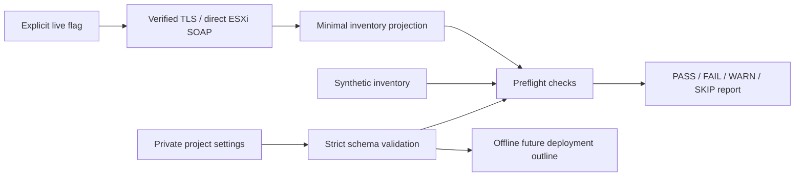

# Architecture

The automation boundary is a single standalone ESXi host. “Standalone ESXi” is
independent of the ISE node persona: a VM may later serve as a standalone ISE
administration node or join an ISE deployment.

`config.py` validates local JSON without DNS, credential lookup, or remote calls.
`preflight.py` is a pure evaluator shared by fixture and live modes. `esxi.py`
provides the optional pyVmomi adapter. `cli.py` gates that adapter behind `--live`.
`planning.py` returns a static sequence without identifiers or secrets.

The adapter authenticates to the host's SOAP SDK endpoint and requires
`ServiceContent.about.apiType == HostAgent`. It walks existing Folder, Datacenter,
ComputeResource, and HostSystem references. Datacenter here is a SOAP inventory
container, not a requirement for a vCenter server. It reads host summaries,
datastores, networks, and VM names. It does not read VM extraConfig or guest data.
It attempts logout/connection cleanup in `finally`. The SDK may suppress a logout
failure, so successful return does not prove immediate server-side session removal.
Login/logout create session/audit activity; “read-only”
means no infrastructure configuration or power-state changes.

No vCenter REST `/api/vcenter` endpoints, Content Library, cluster placement,
DRS, distributed switch management, or cloning APIs are assumed. Standard port
groups are the initial project scope. See the
[Broadcom HostSystem API](https://developer.broadcom.com/xapis/vsphere-web-services-api/latest/vim.HostSystem.html)
and [pyVmomi connection implementation](https://github.com/vmware/pyvmomi/blob/master/pyVim/connect.py).

## Extension contract

Future deployment must have a separate reviewed writer adapter. Keep preflight
credentials read-only. Verify direct-host support and license entitlement for the
chosen VM import/create path before implementing it; successful inventory reads
do not prove write API availability. Neither broad administrator access nor
vCenter presence should be an implicit prerequisite.

The future writer should compare intended state, refuse existing-name collisions,
bind operations to a reviewed host and VM identity, and produce a scrubbed plan
before writes. Re-read capacity immediately before execution. A workflow outline
is not an executable plan and cannot safely be treated as one.

Keep these lifecycles separate: infrastructure creation, private ZTP payload
handling, guest installation verification, backup restoration, and production
cutover. Do not add backup paths or encryption keys as speculative Cisco ZTP
settings. Do not add a broad “execute shell” escape hatch to the read-only adapter.
